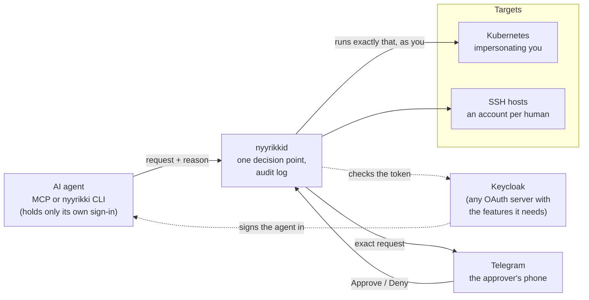

# Nyyrikki

[](https://github.com/Tuhis/Nyyrikki/actions/workflows/ci.yml)
[](https://github.com/Tuhis/Nyyrikki/actions/workflows/e2e.yml)
[](https://github.com/Tuhis/Nyyrikki/releases)
[](LICENSE)

A gateway that lets AI agents run privileged actions through MCP or a
CLI, with each escalation approved by a human on Telegram.

> **Status.** Nyyrikki is before 1.0. It runs on its maintainer's own
> cluster, but its security model has not been reviewed by anyone
> independent, and one person maintains it. Read
> [SECURITY.md](SECURITY.md) for what it protects, what it trusts and the
> risks it accepts before you put it in front of anything that matters.
> What is built and what is still open is in [ROADMAP.md](ROADMAP.md).

An agent connects to Nyyrikki as an MCP server, or calls its command-line
client from a shell, and asks it to do things the agent can't do itself,
such as deleting a pod with `kubectl` or running a command on a server
over SSH. Nyyrikki passes the agent's request through to the target
system, using credentials that only Nyyrikki holds. Nothing privileged
runs without a person's approval. The agent can ask for one request to be
approved, or ask for a short window (up to 30 minutes) on one or more
systems, during which its requests to those systems run without asking
again. The approver gets a Telegram message showing exactly what was
asked for, and answers from their phone. No answer means no.

Wherever the target system allows it, Nyyrikki acts as the person the
agent works for, so the target's own logs show that person rather than a
shared service account. Nyyrikki never hands a credential to the agent.
(A request you approve, or one under an elevation you grant, runs with
your rights, so it can read whatever you can read; see
[SECURITY.md](SECURITY.md).)

## How it works



1. The agent signs in once, through an OAuth device or browser flow that
   you complete. It holds a token for Nyyrikki and nothing else.
2. It sends a request, for example
   `nyyrikki run --reason "web-0 is stuck" prod -- delete pod web-0 -n shop`.
3. Nyyrikki checks who the agent is and which human it works for, parses
   the request into the exact form it will forward, and asks you.
4. You see that form on Telegram and tap Approve or Deny. Nothing else
   approves it: no MCP tool, no CLI command, and no answer within the
   time limit is a deny.
5. On Approve, Nyyrikki runs exactly what you saw, as you, and returns
   the target's response to the agent. Every step is in the audit log.

An approval message looks like this (the text is Nyyrikki's own; the
reason is set apart because the agent wrote it):

```text
Run request on prod
Runs as: alice@example.com, groups oncall
Agent: Claude Code (name claimed by the client)
key ab12cd34, signed in 2026-10-26 11:00:00 UTC

Request:
kubectl delete --namespace=shop pod web-0

Agent's claim (unverified):
│ web-0 is stuck in CrashLoopBackOff

Answer by: 12:05:00 UTC
                         [ Approve ]  [ Deny ]
```

## Features

- **Pass-through, not a tool catalogue.** The agent sends a `kubectl`
  command line or a shell command; the approver sees it as it will run.
- **One-off approvals and time-boxed elevations** of at most 30 minutes,
  bound to one agent and carried as a secret handle.
- **Acts as the human.** On Kubernetes through impersonation, capped at
  the human's own rights. On SSH hosts, as a local account per human
  that only Nyyrikki's short-lived certificates can log in to, with root
  through sudo only where a host opts in.
- **Kubernetes**, in the same cluster or remote, including interactive
  `exec` and `attach` through the CLI.
- **SSH hosts**, enrolled with one command on the host and one tap on
  Telegram, trusted through a host CA that rotates without visiting
  every host.
- **MCP and CLI as equal clients** of one API: the CLI lets an agent pipe
  output through its shell, and MCP harnesses sign in with their own
  OAuth flow.
- **Fails closed.** An unreachable authorization server, Telegram or
  target means deny.
- **Audited.** Every request, approval, denial and elevation, in an
  append-only SQLite table and as JSON lines on stdout.
- **One Helm chart, one pod**, a static Go binary on distroless.

## Getting started

- **Try it locally** (Linux): [docs/setup/quickstart.md](docs/setup/quickstart.md)
  builds a kind cluster, Keycloak and Nyyrikki from the checkout with a
  throwaway Telegram bot of your own, and puts the agent in a pod.
- **Install**: [docs/setup/](docs/setup/README.md) walks through
  Keycloak, the Telegram bot, the Helm chart and signing agents in.
- **Releases**: the image is `ghcr.io/tuhis/nyyrikki`, the chart
  `oci://ghcr.io/tuhis/charts/nyyrikki`, and CLI binaries for Linux and
  macOS are on the [releases page](https://github.com/Tuhis/Nyyrikki/releases).
- **Build from source**: Go 1.26 or newer,
  `CGO_ENABLED=0 go build -o bin/ ./cmd/nyyrikkid ./cmd/nyyrikki`.

## Documentation

| | |
|---|---|
| **Setting it up** | [`docs/setup/`](docs/setup/README.md) |
| **Why it is built this way** | [`docs/`](docs/README.md): one design doc per roadmap item, starting with [docs/01](docs/01-foundations.md) |
| **What's built, what's next** | [`ROADMAP.md`](ROADMAP.md) |
| **Threat model, reporting a vulnerability** | [`SECURITY.md`](SECURITY.md) |
| **Known bugs** | [`BUGS.md`](BUGS.md) |
| **Gotchas** | [`docs/gotchas.md`](docs/gotchas.md) |
| **Contributing** | [`CONTRIBUTING.md`](CONTRIBUTING.md) · [`CODE-REVIEW.md`](CODE-REVIEW.md) |

## License

[Apache-2.0](LICENSE).
